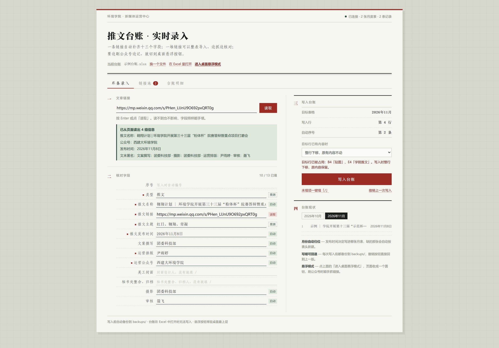
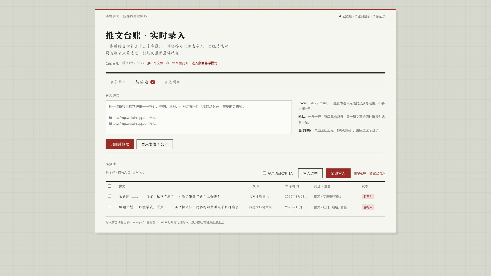
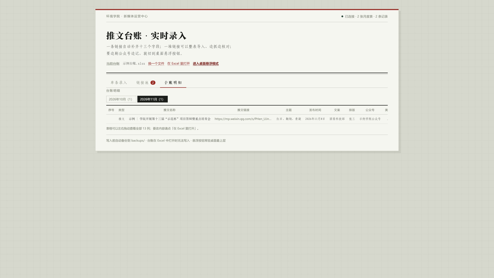

# 推文台账助手 · WeChat Article Ledger

> 把微信公众号文章链接变成表格里的一行。一条链接自动补齐字段，一堆链接整表导入，边刷公众号边用桌面悬浮按钮抓。

一个跑在本机的小工具：Python 起一个本地服务负责抓取解析和写 Excel，浏览器里是录入界面，桌面上还有一个常驻的悬浮圆钮。
不依赖任何第三方 SDK、不需要登录、不需要公众号后台权限，**数据一步都不出本机**。



## 它能做什么

| | |
| --- | --- |
| **单条录入** | 粘一条公众号链接，自动读出标题、公众号、发布时间、文末署名（供稿/摄影/排版/审核），并按关键词推测「类型」和「主题」，缺的字段当场标红让你补 |
| **批量导入** | 把一堆链接整段粘进来（换行、空格、逗号、引号混排都行，自动去重），或者直接上传一张全是链接的 Excel / CSV / TXT，逐单元格找链接，不要求列名 |
| **链接池** | 抓到的条目先落在池子里，可以逐条改字段、看缺什么、勾选后一次性写进台账；已写入的标好「表名 + 行号」 |
| **桌面悬浮按钮** | 页面收成一个常驻最上层的小圆钮；鼠标移上去展开「抓取链接 / 退出」。点抓取就把当前这篇文章缓存进池子，退出回到网页看结果 |
| **写 Excel** | 按发布时间自动归到对应月表（缺表按表头新建），目标行有内容时整行下移不覆盖，写入前自动备份，可一键撤销 |
| **只读表也不怕** | 微信收到的表格默认只读，程序自动复制一份工作副本再动笔，原文件一个字节不改 |

## 快速开始（Windows）

需要 Python 3.9+（有 `openpyxl`；没有就 `pip install openpyxl`）。

```bat
启动.cmd            :: 起服务并打开网页 http://127.0.0.1:8770
启动悬浮按钮.cmd     :: 只起桌面悬浮圆钮（后台服务会自动拉起）
停止.cmd            :: 关掉悬浮按钮和服务
```

第一次打开点「换一个文件」选你的台账 xlsx，之后会记住。
`demo/示例台账.xlsx` 是个可以直接用的模板（13 列 + 月表），`demo/链接清单.xlsx` 是批量导入的示例。

## 悬浮按钮怎么用

1. 点网页上的「进入桌面悬浮模式」，或直接双击 `启动悬浮按钮.cmd`。
2. 桌面右侧出现一个「记」字圆钮，可以拖着走；鼠标移上去向左展开两个按钮。
3. 在浏览器或微信里打开你要记的那篇推文，把鼠标移回圆钮，点 **抓取链接**。
4. 弹「已缓存：《标题》」，圆钮右上角的数字是池子里还没写入的条数。
5. 点 **退出** 收起圆钮、回到网页，缓存的都在「链接池」里。


### 抓链接是怎么抓的

点一下之后，按下面的顺序试，哪一步成立就立刻返回，所以正常情况下是「秒出」：

| 顺序 | 手段 | 说明 |
| --- | --- | --- |
| 1 | 剪贴板 | 15 秒内刚复制过就直接用；更早复制的内容要拿`/api/peek`读出标题、和你当前窗口标题比一遍，对不上就判定为**旧链接**并跳过 |
| 2 | 浏览器地址栏 | 前台是 Chrome/Edge/360/QQ 浏览器等：把浏览器提到前面，`Ctrl+L` 选中地址栏 + `Ctrl+C`，再读剪贴板 |
| 3 | 浏览器历史 | 用前台窗口标题（也就是文章标题）去 Chrome/Edge 历史库（只读打开、不写）里找最近访问的同一篇 |
| 4 | 等你复制 | 前三条都不成：圆钮提示「复制一下链接，我在等（20 秒）」，这期间你复制了链接就自动抓 |
| 5 | 手动粘贴 | 还没中：弹一个小输入框，粘一次即可 |

第 2、3 步都会先看「前台窗口是不是 25 秒内刚活跃过」，避免抢你已经切走的窗口的焦点。
抓到之后还会拿文章标题和你当前窗口的标题比对一次，对不上会明确提示「缓存了《X》，但和你当前页面标题对不上」。

### 微信 PC 客户端里怎么办

微信内置浏览器没有地址栏，第 2 步用不上。做法有两个：

- **复制再点**：文章右上角 `⋯`（或右键）→「复制链接」，然后点圆钮上的「抓取链接」。
- **点完再复制**：直接点「抓取链接」，它会等你 20 秒，这期间去复制链接就会自动接住。

## 批量导入



- **粘贴**：整段扔进去就行，`extract_links` 会把 `mp.weixin.qq.com` 的链接一条条抠出来，同一篇文章的不同链接形式（`/s/xxxx` 与 `/s?__biz=…&mid=…`）算同一条。
- **表格**：.xlsx/.xlsm 会逐单元格扫描（不要求哪一列），.csv/.txt/.md/.html 按文本扫。
- 抓取是后台线程 + 进度条，一次几十条也能边抓边看；失败的单条留在池里标「抓取失败」，不影响其他条目。
- 写入前可以勾「缺失项自动填「/」」，把没读到的非必填字段统一填斜杠。

## 自动填充对照

| 表头 | 来源 |
| --- | --- |
| 序号 | 按当月记录数自动编号 |
| 类型 | 正文含视频载体 → 视频；正文很短且图多 → 贴图；其余 → 推文 |
| 推文名称 | `og:title` / `var msg_title` |
| 推文链接 | 你贴的链接 |
| 推文主题 | 标题优先、正文兜底的关键词判定（可自行改 `THEME_RULES`） |
| 推文发布时间 | `var ct` 时间戳或页面日期，统一成「2026年11月8日」 |
| 文案撰写 | 文末「供稿 / 文案 / 图文来源」 |
| 运营排版 | 文末「编辑 / 排版」 |
| 运营公众号 | `var nickname` / `id="js_name"` |
| 美工封面 | 文末「封面 / 美编 / 设计」 |
| 秘书处整合、归档 | 文末「归档 / 整理」，多数情况手填 |
| 摄影 | 文末「摄影 / 图片 / 图文来源」 |
| 审核 | 文末「审核 / 终审 / 责编 / 指导老师」 |

## 台账明细



## 字段能不能改

13 个字段定义在 `server.py` 顶部的 `FIELDS`（列号、表头、是否必填、候选值），改成你自己的表就行：
改列号 + 表头即可，其余逻辑都按这份定义走。月表命名规则是 `YYYY年M月`。

## 目录

```
.
├─ server.py                本地服务：抓取解析 / 链接池 / 写 Excel / 悬浮按钮的启停
├─ floater.py               桌面悬浮圆钮（tkinter，常驻最上层）
├─ 启动.cmd / 启动悬浮按钮.cmd / 停止.cmd
├─ web/                     index.html · style.css · app.js（零依赖原生 JS）
├─ demo/                    示例台账 + 链接清单
├─ docs/                    截图
├─ 台账/                     工作副本（运行时生成）
├─ backups/                 每次写入前的自动备份，保留最近 40 份
└─ data/                    pool.json 链接池 · runtime.json 端口/进程 · floater.log
```

## HTTP 接口

```
GET  /api/state              台账信息、字段定义、候选值
GET  /api/rows               各月表记录
POST /api/parse              单链接解析
POST /api/preview            写入落点预览（哪张表、第几行、序号）
POST /api/append             单条写入
POST /api/undo               还原上一份备份
POST /api/urls/extract       从文本里抠链接
POST /api/urls/upload        上传 xlsx/csv/txt 抠链接
POST /api/pool/fetch         批量抓取入池（后台任务）
GET  /api/pool               链接池 + 任务进度
POST /api/pool/write         批量写入
POST /api/pool/update|remove|clear
POST /api/peek               只读一条链接的标题（悬浮按钮核对「剪贴板里是不是当前这篇」）
POST /api/capture            悬浮按钮用的单条抓取（可带 title_hint 做标题校验）
POST /api/floating/start|stop|hello
GET  /api/ping
```

## 常见问题

**悬浮按钮点了没反应？**
先看 `data/floater.log`，里面有每一步的判定：前台是哪个窗口、地址栏读到什么、历史有没有命中。
按钮旁边出现「⋯」表示正在抓。

**抓到的是上一篇/别的文章？**
现在只认「标题核实通过」的链接：候选链接先读出标题，和当前窗口标题比对，对不上绝不入池，也不再拿浏览器历史顶替当前页面。
无法自动核实（比如微信主窗口标题不是文章标题）时，会弹确认框让你手动核对一次再入池。

**读出来是「微信返回的是验证页」？**
抓太频繁被微信拦了一下，等几分钟再试；链接已经进池子了，也可以去池子里手填字段。

**台账在 Excel 里开着，写不进去？**
文件被占用，关掉表格再点写入。

**只在 Windows 上验证过**（tkinter 悬浮窗 + 中文 Excel 字体）。


## 自动记录器（C++ 版 · 全电脑）

双击 `启动监控.cmd`，打开即自动监控**全电脑**的公众号链接，无需任何手动操作：

- **浏览器历史**：Chrome / Edge / Brave / 360 / QQ浏览器 / 360Chrome 的 History，以及 Firefox 的 places.sqlite —— 浏览器里打开公众号文章，历史一更新就自动记录。
- **全局剪贴板**：任何程序（微信客户端、浏览器、任意地方）复制了公众号链接，立即记录，并尝试抓取文章标题。

记录写入 `cpp\data\wechat_links.csv`（UTF-8，含时间/标题/链接/来源）和 `wechat_links.jsonl`，同一篇文章自动去重不重复记。

**实现要点**：
- 纯 C++（MSVC 编译），零外部依赖 —— SQLite 用 Windows 自带 `winsqlite3.dll` 动态加载，标题用 WinHTTP 抓取。
- 内存/资源治理：所有句柄（SQLite/WinHTTP/剪贴板）RAII 自动释放；标题抓取带缓存（同篇不重复请求）；记录批量落盘减少 IO；Ctrl+C 优雅退出（flush 缓冲 + 关文件）。
- 微信 PC 客户端里文章存在加密数据库、链接不对外暴露，只能靠「复制链接」触发记录（剪贴板监听自动兜底）。

源码：`cpp\wechat_link_watcher.cpp`，编译脚本 `cpp\build.bat`。


## 桌面软件（C++ 内核 + Java 窗口）

双击 `推文台账.exe` —— 打开桌面窗口，无控制台、无 cmd。

**架构**：C++ 负责全部逻辑（HTTP 服务 8780、文章抓取解析、链接池、写 xlsx、剪贴板监听、配置），Java 只做窗口（JavaFX WebView 渲染界面）。

### 动态识别（主页面，每秒刷新）

- **浏览器**：打开公众号文章 → 浏览器历史更新 → 1 秒内出现在列表
- **剪贴板**：任何地方复制文章链接 → **立即**记录（内核监听剪贴板事件，不等轮询）→ 界面 1 秒内显示
- 每条可点「加入链接池」，补全字段后一键写入台账

### 选择台账与插入方式

- **首次启动**会弹框让你选一个 Excel 台账（13 列：序号/类型/推文名称/…/审核），选完记住；之后界面「换一个文件」可更换。
- **写入用 COM 直接写进你的 Excel**（保留原有格式与月份分表），支持两种插入方式：
  - **接着顺序插入**：追加到当月 sheet 的最后一行
  - **插入到指定行**：填行号（如 4），该行起整体下移，新记录插在该行
- 日期、文本按文本格式写入，不会被 Excel 自动转成数字。

### 存储与台账

- 数据目录可改：界面「换一个文件」→ 弹 Windows 目录选择框
- 台账：`data\推文台账.xlsx`，按发布时间自动分月 sheet（Excel 直接打开）

### 组件

| 文件 | 作用 |
| --- | --- |
| `推文台账.exe` | C++ 内核（服务 + 抓取 + 台账 + 剪贴板监听），启动时拉起窗口 |
| `java\` | 窗口 UI（内置 JRE + JavaFX，无需安装） |
| `web\` | 界面页面 |

源码：`kernel\kernel.cpp`、`java\DesktopApp.java`。

## License

MIT